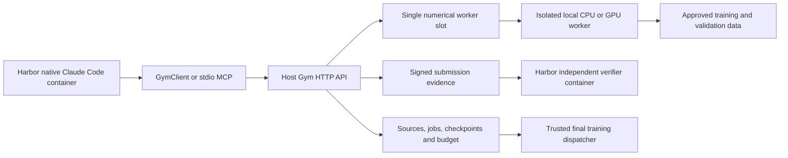

# Gym design and API

This is the current repository-local auto-research design, replacing the earlier
proposal and roadmap. Harbor and the shared scientific core are unchanged.
[README.md](README.md) covers installation; [CANDIDATE_API.md](CANDIDATE_API.md)
defines exact source/configuration inputs; [TESTING.md](TESTING.md) lists checks.

## Architecture



Harbor 0.24.0 and task schema 1.4 own the native Claude Code lifecycle, containers,
trajectory and artifact collection. Gym owns training, resources, retained source
and evaluation. Agent collaboration and provider choice do not change the API,
session budget or numerical concurrency. There is no custom Agent reasoning loop.

The Agent develops native plugins in a container with internet access. Research
information comes through Gym, without a repository checkout or Git history.
The launcher starts a per-trial host service, then stops research and signs
verification evidence when the Agent ends. Disk state outlives the trial. This is
not a persistent multi-tenant deployment manager. Reusing a service state reuses
its persisted listener port; a new trial has separate state and a new listener.

## Operation reference

Read endpoint/token/session ID from `/run/gym-auth/credential.json`. Send JSON
`POST /v1/call` with `schema_version="gym.api.v1"`, `operation` and `params`, plus
`Authorization: Bearer <token>`. HTTP success wraps `result`; SDK/MCP expose it.
`describe_space.operation_schemas` defines parameter types, required fields,
bounds and descriptions. HTTP validates these before semantic dispatch. MCP
uses the same definitions and forwards calls to HTTP.

The table omits mutation `idempotency_key` (required, 1–128 characters). Retry
identical input with the same key; changed input needs a new key. Quotation creates
state but reserves no budget and does not need a key. Optional pagination uses
`cursor` and `limit` (1–100, default 50). Candidate/profile IDs are strings.

| Operation | Required parameters | Optional parameters | Behavior |
| --- | --- | --- | --- |
| `describe_space` | None | None | Read supported profiles, candidate_contract (native model config schema and merge rules), per-profile model_config_constraints and authoritative HTTP operation schemas. |
| `get_resources` | None | `resource_profile_id` | Observe nodes, discovered/allocated/available GPUs, memory and worker slots. Configuration is operator-owned. |
| `list_components` | None | `cursor`, `limit` | List approved architecture source references with pagination. |
| `read_reference` | `resource_id` | None | Read one approved reference by ID; arbitrary filesystem paths are not accepted. |
| `get_candidate` | `candidate_id` | None | Read this session's immutable candidate metadata and native model config. |
| `list_candidates` | None | `cursor`, `limit` | List this session's candidates. |
| `submit_candidate` | `package_base64` | None | Upload a base64-encoded source-only native plugin ZIP containing proposal.json, architecture.json (native ModelConfig), plugin/<method>/method.json and __init__.py. Read describe_space.candidate_contract first. Config/source changes create a new immutable candidate. No training scripts, weights or command overrides. |
| `inspect_cost` | `candidate_id`, `profile_id` | None | Inspect the selected candidate/profile's parameter count and traced FLOPs before training. |
| `quote_experiment` | `candidate_id`, `profile_id` | `target_update`, `checkpoint_id`, `resource_profile_id`, `gpu_id`, `server_id` | Quote fixed-profile work to an absolute target update, optionally continuing a checkpoint and choosing an authorized node/GPU. Omit GPU to let Gym select an idle allocated card. |
| `run_experiment` | `quote_id` | None | Consume a quote and reserve its cost from the session's fixed research allocation. Gym queues and executes it. |
| `validate_candidate` | `candidate_id`, `profile_id` | None | Run charged bounded loading/numerical/causal/checkpoint/cost checks under an approved profile. |
| `debug_candidate` | `candidate_id`, `profile_id`, `check` | `shape` | Queue the selected diagnostic and required prerequisites; independently charged, never grants final admission. |
| `calibrate_candidate` | `candidate_id`, `profile_id`, `grid` | None | Statically inspect at most 32 native ModelConfig alternatives using the candidate's unchanged plugin. Each grid item replaces architecture.json completely, not as a patch; returns derived candidates and costs. Read describe_space.candidate_contract for types and profile constraints. Does not train or measure GPU throughput. |
| `get_job` | `job_id` | None | Read job state, placement, waiting reason and measured worker execution details. |
| `get_result` | `job_id` | None | Read the completed experiment result and charged budget. |
| `cancel_job` | `job_id` | None | Cancel queued work or request cancellation at a reconciled numerical boundary. |
| `read_events` | None | `cursor`, `limit` | Read this session's lifecycle/accounting events. |
| `get_budget` | None | None | Read the fixed total, spent, reserved and remaining research FLOPs. |
| `finalize` | `candidate_id`, `profile_id` | None | Freeze one admitted candidate; Gym retains its source/config. Final training is separately dispatched by the platform. |
| `get_submission` | `submission_id` | None | Read this session's frozen submission and final-run status. |
| `list_experiments` | None | `scope`, `cursor`, `limit` | List published historical experiments or private experiments from this session only. |
| `read_experiment` | `experiment_id` | `scope` | Read experiment results, model/config information, source references and provenance. |

Diagnostics are `construction`, `numerical`, `causal`, `checkpoint` and
`cost_coverage`. Optional `shape` must match the profile batch size/sequence length.
Each check charges its required setup and numerical work. Partial diagnostics
never replace full final-profile validation. Static calibration returns a completed
job whose result contains derived candidates and costs; it does not train.

`get_result` returns `not_found` until a result exists. Poll `get_job` first or use
`GymClient.wait_result`. A successful check job means execution completed; inspect
its check booleans and `admitted` before concluding the candidate passed.
Errors carry `code`, `hint`, `phase`, `retryable` and `details`; MCP preserves the
HTTP error and adds `isError`.

## Dataset split

| Set | Contents | Use |
| --- | --- | --- |
| Train | Ordered ClimbMix prefix through shard 06541 at full scale | Gym training |
| Validation | Last shard, `shard_06542.parquet`, matching native defaults | Agent-visible feedback for algorithm selection |
| Test | CORE-22 | New-candidate scoring only after freezing and fresh final training |

Operators pin manifests and tokenizer before research. Shipped profiles use
labelled synthetic fixtures. Historical published CORE results and public web
research remain accessible: this is a feedback-access boundary, not a claim that
the public benchmark has never been seen by the Agent.

## Candidate runtime

`reference_plugin_v1` uses NextTransformer's existing native Python plugin
contract. `method.json` has the same `name`, `family`, `options`, `debug_options`,
`shell` and `layer_multiple` semantics as `nexttransformer/models/plugins.py`.
`__init__.py` exports native hooks: `model`, `mixer`, `ffn`, `block`, and the
associated initialization/check/stage hooks. A `model` subclasses `ReferenceLM`.
The native loader validates hook compatibility and the shared projection layout.
There is no Gym expression language or model-source translation.

The source-only submission envelope is:

```
proposal.json
architecture.json
plugin/<method>/method.json
plugin/<method>/__init__.py
plugin/<method>/<optional local Python modules>
```

The plugin directory is copied byte-for-byte to a worker plugin root (loaded with
`NEXTTRANSFORMER_METHOD_PATHS`) or the final snapshot's
`nexttransformer/methods/<method>/`. Relative imports and local packages work through
the native loader. The same original method name, source files and metadata reach
both paths; no generated replacement model is used.

`architecture.json` contains native `ModelConfig` fields and the plugin's declared
`options`. `describe_space.candidate_contract` publishes their JSON types and merge
rules; each public profile publishes `model_config_constraints`. See
[CANDIDATE_API.md](CANDIDATE_API.md) for requests and config-only submissions.
Upload checks native field types without importing candidate code; native worker
validation owns architecture semantics. Execution profiles pin
width, heads, context, vocabulary and formal/debug scale; explicit submitted values
must match. A serialized native config may include the fixed seed and scale unchanged.
Optimizer settings, data paths and commands are not architecture fields. Formal admission still enforces the unchanged scientific protocol.

`proposal.json` is Gym identity/provenance metadata only: schema `gym.candidate.v1`,
SDK `reference_plugin_v1`, method, optional parent IDs and hypothesis. Packages are
bounded to 1 MiB and 32 text files. Traversal, symlinks, duplicate paths, runtime
shadowing, binaries, weights and dependency installers are rejected. Additional
Python files must remain inside the declared plugin. Ingestion reads metadata and
configuration without importing, interpreting or rewriting model source. Syntax,
imports, native hooks, shapes and numerical behavior are checked in the worker.

Research imports, shape inspection and numerical execution run in fresh bubblewrap
user/mount/PID/network namespaces. Only runtime libraries, read-only platform code,
approved data and the current job's output/checkpoint are mounted. Controller
state, credential volumes, host processes and host networking are not mounted.
There is no unsandboxed research fallback. CPU inspection receives no GPU devices.
Configured CUDA research workers receive only the selected NVIDIA device plus its
control/UVM devices and read-only driver metadata, with a private PID procfs.
GPU execution requires an operator allocation and a CUDA-enabled worker runtime.

## API and persistence

Every HTTP call uses `/v1/call`, schema `gym.api.v1`, an operation, a JSON
parameter object, and a bearer session credential. The SDK sends only these
messages. HTTP owns the canonical operation schemas exposed by `describe_space`.
The stdio MCP adapter discovers those schemas and forwards tool calls to HTTP;
it preserves authorization, budget/idempotency rules, results and error envelopes. Agent and verifier credentials have separate scopes. Sessions and
allocations can only be created through a trusted local controller.

The operation reference above covers space/resources/catalog,
source submission and reads, cost inspection, charged validation/debugging,
static calibration, quote/run, jobs/events/results, cancellation, budget reads,
finalization and submission reads. HTTP validates published input schemas before semantic dispatch. Mutations require idempotency keys; a key
cannot be rebound to different content. Unknown parameters are rejected.
Candidate/event pagination uses stable cursors. Calibration is a completed
static-analysis job returning derived immutable candidates and cost reports.

`list_experiments` and `read_experiment` expose published historical runs or the
current session's numerical experiments. Published results include corresponding
current model configurations, hash-match status and architecture source reference
IDs. They explicitly distinguish present reference code from historical source.
They do not expose test datasets or an evaluation API for new candidates. Private
session history remains owner-scoped. The reference catalog is a bounded allowlist,
not a filesystem or Git access API.

Quotes bind source, profile, runtime revision, checkpoint, resource profile and
absolute target update. A quote expires after five minutes and is consumed once.
Reservations and jobs commit in one SQLite transaction. FLOPs amounts cross the
wire as decimal strings. Source storage has a 128-candidate session limit.
The initial scheduler serializes numerical workers on one declared resource slot;
the account remains concurrency-safe across simultaneous callers.

## Numerical accounting and checkpoints

Static analysis uses the existing shape-only FakeTensor/ATen cost convention,
including separate initialization, forward, backward, optimizer, prediction and
dev-scoring paths. This audits the traced native execution for the selected config.
It does not prove coverage of every data-dependent Python branch. Native Python
shares a process with numerical accounting and scoring code: namespace isolation
is not a proof against malicious monkeypatching, forged worker messages or hidden
computation. The native path therefore assumes protocol-conforming cohort code;
arbitrary adversarial Python accounting requires an additional execution trust
boundary before production use. Reports explicitly identify their traced scope.
Each numerical operation requires a durable intent and controller acknowledgement.
The worker then reports completion using a unique charge identity. Unknown work
retains its reservation. A stopped crashed worker can be explicitly reconciled
by charging its remaining conservative bound; there is no automatic refund.
Known numerical failures consume the current operation's conservative bound and
report `numerical_failure`; cancellation stops at a reconciled operation boundary.
Final allocation exhaustion reports `budget_stopped`. Unknown worker failures stay
in `reconciliation`, with their reservations retained until termination is confirmed.

Checkpoint artifacts retain model/optimizer/RNG/routing/data-buffer/schedule/stage
and cumulative training state. They are private to the service, hash checked on
continuation, and bound to exact candidate/profile/runtime identities. Source
changes start over. Dev scoring is performed by trusted code from predictions,
labels and token-byte lengths; candidate-returned metrics are never accepted.

The parquet adapter selects an explicit contiguous training prefix up to and
including `shard_06541.parquet`, excluding the pinned native `VALIDATION_SHARD`
(`shard_06542.parquet`). Validation selects only that last shard, matching the
repository's default split. The existing profile key `dev_path`, `dev_batches`
and result key `dev_bpb` now refer to this research-visible validation feedback;
`dev_path` must name the pinned last shard. The stream accepts `val` and the legacy
`dev` alias, using native `val` semantics for both. CORE-22 remains outside research
data views. The adapter reuses upstream best-fit row generation and refuses
training-prefix exhaustion.
The shipped profile uses deterministic synthetic data, explicitly labelled as a
fixture; it is never presented as ClimbMix or as a formal comparison.

## Harbor and agent runtime

Gym runs on the host by default. Harbor owns the Agent and independent verifier
containers, native Agent execution, artifact collection and teardown. The client
image contains the HTTP SDK, thin MCP adapter, package example and runtime helper.
No platform source, dataset, checkpoint root, GPU device, verifier secret or Docker
socket is mounted into the Agent. Host training state and role credentials remain
in separate directories; each container mounts only its own credential read-only.
The verifier runs in a network-disabled container.

The host HTTP listener binds an OS-assigned port once on the Docker bridge address,
retains the bound socket and persists the port in its service state. It reuses that
port on restart and fails on conflicts. The Agent uses the same credential file,
HTTP endpoint contract and MCP tools as before. The controller starts the local
scheduler, then uses Harbor's native lifecycle hooks to stop/settle numerical work
and sign evidence from the live Gym before verification. Only signed public evidence
is mounted read-only into the Agent for Harbor artifact collection. The signing
credential and training state are never exposed there. Host state outlives the trial.

The launcher defaults to Harbor's built-in `claude-code`, with native model,
version, turn and USD options. There is no Gym Agent subclass or model broker.
The Agent has shell tools and outbound networking. The host Gym exposes only its
authenticated HTTP API; numerical workers remain network-isolated. Provider credentials
follow Harbor's native Agent authentication; they are not placed in Gym state or
trial binding receipts. The Gym ledger meters service numerical work, not Agent
inference or arbitrary local shell CPU. The oracle is an explicitly selected
bounded test. The local model-stub smoke exercises native Claude Code without
calling an external model provider.

`get_resources` reports the local execution node, CPU/memory capacity, discovered
NVIDIA devices, operator-allocated devices and observed availability. Device rows
include UUID/index, name, free/total memory, utilization and busy reasons. The
launcher passes its node identity into the host service. Agent quotes may choose that
node, an allocated GPU and an absolute target update within the fixed profile.
The backend launches the fixed trainer locally; it accepts no shell, environment,
data-path or remote-execution overrides. Each service state supports one shared
worker slot; running/cancelling/uncertain jobs from its sessions affect availability.
Run one research trial at a time for the agreed single-machine/single-job setup.
Separate service states do not share a machine-wide scheduler lock; the GPU lease
only prevents participating Gym instances from sharing the same allocated card.

GPU jobs acquire a cooperative lease and recheck host occupancy before launch.
If capacity is unavailable they remain queued with a waiting reason and reserved
budget, without numerical charges or CPU fallback. Leases coordinate same-user
Gym processes sharing the host lease directory, not unrelated host applications. Operators must allocate dedicated cards
across those boundaries. The GPU memory policy uses conservative quote admission
and the PyTorch allocator fraction, not a hardware memory partition or a guarantee
against arbitrary direct CUDA allocations. By default, any compute or graphics
process blocks dispatch. Operator-only `allow_idle_graphics=true` permits existing
graphics processes when observed utilization is zero, compute-process count is
zero, and memory/lease checks pass. Unknown or mixed process observations still
block dispatch. This opt-in policy does not reserve the GPU against unrelated
applications or guarantee their future inactivity. Results record measured parameter
devices, runtime versions and peak memory. The agreed execution scope is one
local machine and one concurrent numerical job. Remote nodes and parallel
workers are outside scope. Host GPU execution uses an operator-selected CUDA
Python environment directly and requires no CUDA container image. There is no Gym service container backend.

`HarborRuntime(environment).snapshot()` uses Harbor's real environment `exec`
API to read the main container's `/proc` state. Optional Agent-reported state is
labelled separately and is not required from native Claude Code. Collect hooks retain that snapshot and authenticated
Gym evidence as native Harbor artifacts. No host-side launch flag substitutes
for runtime observation.

## Final verification and execution

Finalization requires successful exact-identity reports and final admission,
a reconciled account and no active jobs. It freezes one choice. The separate
Harbor verifier checks a receipt against HMAC-authenticated server evidence and
its trusted per-trial binding. Reward 1 means deliverable validity only. There is
no automatic final launch, model performance reward or leaderboard rank.
The receipt contains `session_id`, `submission_id` and `candidate_hash`. Gym keeps
the complete native source package and configuration in durable service state.
Final dispatch resolves that submission and retains its code under the final run's
own account, so training needs neither an exported archive nor a live Agent
workspace. Preserve the trial's host state, pinned numerical environment and source
revision until final training and retention finish.

`prepare-final` creates a separate Git snapshot, copies the original native plugin
without modification, re-audits the selected configuration without searching for a
replacement, runs native admission and pins a source/configuration manifest.
It never changes the source repository or launches training. `launch-final`
requires a verified submission and a distinct finite allocation. The official
adapter invokes native formal training, cumulative audit and result export in
that staging checkout. Single-node dispatch uses 8, 16 or 32 explicitly allocated
GPUs and file rendezvous. Each rank receives a finite allocation share, with exact
rational cost rates rather than floating-point budget arithmetic. Each model call is guarded by a conservative finite
allocation; abnormal termination cannot refund uncertain work. Only a successful
native audit/export yields an official-compatible record. Upstream publication
remains a separate review process.

Bounded final-profile validation/debugging uses one GPU from the operator's
execution allocation, even when the retained final plan specifies multiple GPUs.
Its memory cap is the smaller of the profile and execution-policy caps. This
does not change the frozen plan, device list or profile identity. Public profiles
describe single-device float32 diagnostics separately from operator-only formal
training. Passing a final profile to research `quote_experiment` remains denied.

The shipped fixture exercises separately allocated fresh initialization without
claiming official performance: formal BPB, CORE and rank remain null. A production
final profile needs a reviewed official plan, resources, runtime compatibility
and bounded allocation. The full 49.152B-token run is not part of development tests.

## Trusted controller and crash recovery

Local controller commands require `--state`, `--profiles` and `--platform`. Use the
frozen `<trial>.host/execution.json` as `--execution-config`, not an original GPU
index file: the launcher normalizes indices to UUIDs. Retain the same profiles,
worker Python and server ID. When restarting with `serve`, pass the original bind
address with `--host`; the listener file persists the port, not the bind address.
These are not Agent HTTP operations:

| Command | Purpose |
| --- | --- |
| `prepare-final` | Stage and admit a final plan without training |
| `launch-final` | Separately allocate and queue fresh final training |
| `work-once` | Dispatch one queued operation |
| `get-final` | Read final status/result |
| `reconcile` | Settle confirmed-stopped uncertain work conservatively |
| `snapshot` | Inspect retained session state locally |
| `serve` | Serve retained state with its persisted listener port |

A controller crash can leave `running`, `cancelling` or `reconciliation` persisted.
Establish that the worker has stopped, then use `reconcile --session-id <owner-id>
--job-id <job-id> --worker-confirmed-stopped` with the controller configuration.
Reconciliation acquires the scheduler lock, refuses a still-owned slot, charges
the remaining conservative reservation and marks the job failed. Repeating it
does not double-charge. The confirmation flag asserts termination; it does not
kill a process. Unknown work is never refunded.

## Supported scope and production acceptance

The short CPU path and native loading/loss/gradient/cost/packing/continuation parity are tested.
A production GPU deployment still requires its hardware/runtime parity
validation, dataset/tokenizer manifests, appropriate memory/storage quotas and
full formal-run acceptance. The initial worker pool is single-slot and has no
checkpoint garbage collector. These are explicit deployment/release limits;
this repository does not claim arbitrary Python sandbox safety or completed
production benchmark results.

The research and submission workflow is implemented. Maintained tests exercise
all 22 public operations through HTTP, MCP discovery/error parity and native
research/submission behavior. Production completion still requires selected
ClimbMix/tokenizer manifests, CUDA/runtime parity, final admission resources,
explicit post-acceptance dispatch and full final training/CORE-22 acceptance.
Fixture final results keep formal BPB, CORE and rank null. Static shape audits do
not consume numerical research FLOPs. Checkpoint cleanup remains manual.
